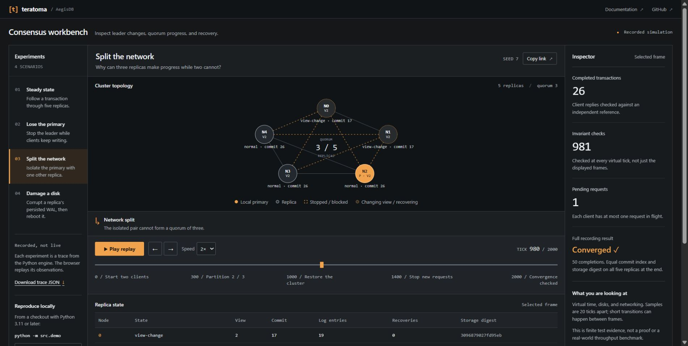

# Teratoma / AegisDB

**Break a replica. Watch the cluster recover.**

[](https://github.com/Vetri1706/teratoma/actions/workflows/ci.yml)

An experimental distributed-systems lab for studying replication, crash recovery,
and protocol safety. **Teratoma** is the repository name; **AegisDB** is the engine
and executable name used in the source.

Run a deterministic five-replica simulation, inspect a failure and recovery trace,
or build the Python/C daemon to exercise real TCP connections and durable files.
The repository also contains a bounded state explorer and a separate Lean 4
protocol-safety development.

[](https://vetri1706.github.io/teratoma/)

**[Open the replay lab](https://vetri1706.github.io/teratoma/)** · [Run it locally](docs/DEMO.md) · [Read the fault model](docs/FAULT_MODEL.md) · [Contribute](CONTRIBUTING.md)

This is a research prototype for isolated local experiments. The native adapter
is not production-qualified; read the [operating contract](docs/FAULT_MODEL.md)
for its trust, persistence, and resource limits before running daemons.

## Try the replay lab

Clone the repository and run commands from its root. The simulator needs
**Python 3.11 or later** and no third-party Python packages or C build.
Use `python3` instead of `python` if that is your interpreter's command.

```sh
git clone https://github.com/Vetri1706/teratoma.git
cd teratoma
python -B -m src.demo --output artifacts/demo
```

Open `artifacts/demo/index.html` in your browser. The report includes the generated
trace data and works locally without a web server. Explore healthy replication,
primary failure, a partition, and recovery from corruption. The browser replays
simulator traces; it does not run the native daemon.

See the [demo guide](docs/DEMO.md) for scenarios and regeneration, or open the
[checked-in replay lab](docs/lab/index.html) from a local clone.

For a longer seeded verification workload:

```sh
python -B -m src.main --seeds 1 --ticks 1000
```

This prints a JSON report. A failing run records its seed and trace in
`failure-trace.json`. The workload uses virtual time, network delivery, and disks;
these results do not measure native throughput or physical-disk durability.

## Choose an experiment

| Path | What you can inspect | Requirements |
| --- | --- | --- |
| Deterministic simulator | Seeded faults, committed results, recovery, and invariant checks | Python 3.11+ |
| Native daemon | Separate processes, TCP transport, WAL fsync, SSTables, and OS faults | Linux or macOS, C11 compiler, CPython embedding headers/library |
| Bounded model | Exhaustive safety exploration within explicit bounds; a failing mutation control | Python 3.11+ |
| Lean development | Unbounded safety statements about the abstract protocol | Lean and Lake 4.19.0; Python verification runner |

The native implementation lives under `src/production/`; that directory name
distinguishes it from the virtual runtime, rather than certifying deployment
readiness. Native Windows is not supported by the POSIX adapter. The portable
simulator and model can be used without it.

## Run checks

Start with the tests that need only Python:

```sh
python -B scripts/test_portable.py
python -B formal/check_model.py
python -B formal/check_model.py --mutation --expect-counterexample
```

The last command succeeds when the checker finds the deliberately broken
election's counterexample. It is a negative control, not a passing protocol run.
The portable runner excludes the tests that require POSIX storage or compiled
native queues; those belong to the separate Linux native job.

For the native build, full tests, five-process chaos workload, and transaction
example, use the [native experiment guide](docs/NATIVE.md). For the separate
proof build, follow the [Lean instructions](formal/unbounded/README.md).

## What is implemented

- Viewstamped replication with a fixed odd-sized replica set and majority quorums.
- Transactions with pre-write reads, conditional writes, and retained client
  results for identical retries.
- A replicated query engine with SUM, COUNT, MIN, MAX, and AVG aggregates.
- Checksummed WAL blocks and checkpointed SSTables in the native adapter.
- Seeded virtual faults and a separate supervisor for real process/network faults.
- Finite-model checks and Lean safety theorems, each with an explicit abstraction.

Protocol proofs, simulation checks, and native tests provide different evidence.
The Lean proof does **not** establish that the executable refines the model,
prove physical storage behavior, or guarantee eventual progress.

## Verification and limits

[Native verification](docs/VERIFICATION.md) and
[Lean verification](docs/UNBOUNDED_VERIFICATION.md) link a fresh Linux CI run and preserve the original
reported experiments and their limits. Their original raw `artifacts/` logs and
archives are not included in this repository. The documentation identifies that
gap and gives commands to produce new evidence.

For current automated runs, inspect [GitHub Actions](https://github.com/Vetri1706/teratoma/actions)
and the tested commit. A historical report or green simulator job is not evidence
that every platform, native fault scenario, or proof build passed.

## Read the code or contribute

| Location | Responsibility |
| --- | --- |
| `src/consensus/` | Replication, elections, recovery, and state-machine application |
| `src/virtual_os/`, `src/testing/` | Deterministic scheduling, faults, and independent checks |
| `src/production/`, `native/` | POSIX transport/storage adapter and C queues/launcher |
| `src/storage/`, `src/query/` | Storage structures and analytical evaluation |
| `formal/`, `formal/unbounded/` | Bounded model and Lean protocol development |

See [CONTRIBUTING.md](CONTRIBUTING.md) for a first local check and a useful bug
report, [the roadmap](docs/ROADMAP.md) for concrete areas to improve, and
[SECURITY.md](SECURITY.md) for the trust boundary and reporting guidance.

Licensed under [Apache License 2.0](LICENSE). The license does not change the
experimental status or the scope of the verification claims.
